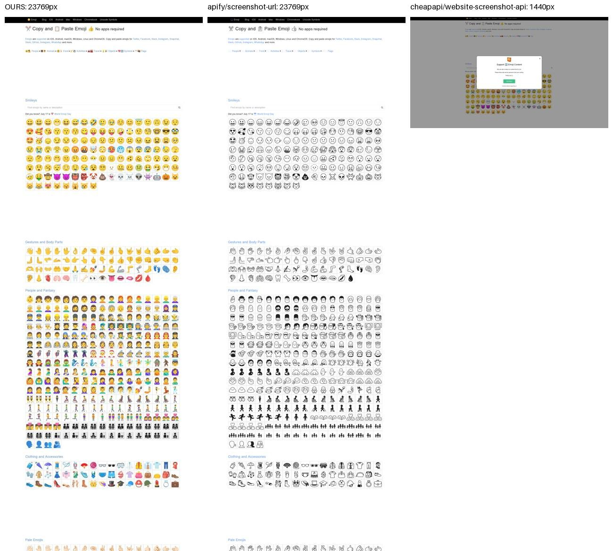

# Website Screenshot API examples: bulk full-page screenshots, sitemaps, visual change detection

[](https://apify.com/tobbyb/website-screenshot)
[](LICENSE)

Copy-paste examples for the [Website Screenshot API on Apify](https://apify.com/tobbyb/website-screenshot):
**true full-page screenshots** (lazy images loaded, sticky headers not repeated, cookie banners removed), in bulk from
URL lists or a `sitemap.xml`, as PNG, JPEG, WebP or PDF, with optional **visual change detection**.

**Pricing: $0.004 per screenshot, no subscription. Failed URLs are free.**

> Disclosure: we build and sell the Actor these examples call. The benchmark below compares it with two other
> Apify screenshot Actors and lists every run ID so the numbers can be checked.

<p align="center"></p>

## Quick start (one HTTP call)

```bash
export APIFY_TOKEN=...   # free account: https://console.apify.com/settings/integrations
curl -sS -X POST "https://api.apify.com/v2/acts/tobbyb~website-screenshot/run-sync-get-dataset-items" \
  -H "Authorization: Bearer $APIFY_TOKEN" -H "Content-Type: application/json" \
  -d '{"urls":["https://example.com"],"devices":["desktop","mobile"],"formats":["png"]}'
```

Each result (shortened, real run):

```json
{
  "status": "ok",
  "url": "https://example.com/",
  "device": "desktop",
  "screenshotUrl": "https://api.apify.com/v2/key-value-stores/<store-id>/records/example-com-desktop-….png?signature=…",
  "imageWidth": 1440,
  "imageHeight": 900,
  "fullPageComplete": true,
  "sheetsImageFormula": "=IMAGE(\"https://api.apify.com/v2/key-value-stores/…\")",
  "charged": true
}
```

A URL that can't be captured comes back as `"status": "error"` with `errorCode`, `errorTitle` and `howToFix`, and is not charged.

## Examples

| Folder | What it does |
|---|---|
| [`examples/curl/screenshot.sh`](examples/curl/screenshot.sh) | Two pages × desktop + mobile, JSON back in one synchronous call |
| [`examples/node/screenshot.mjs`](examples/node/screenshot.mjs) | `apify-client` for Node.js: capture a list of URLs and download the images |
| [`examples/python/screenshot.py`](examples/python/screenshot.py) | `apify-client` for Python: URLs or `--sitemap`, saves PNG files |
| [`examples/python/visual_monitor.py`](examples/python/visual_monitor.py) | Visual change detection with a named monitor; exits 2 when a page changed (CI-friendly) |
| [`examples/github-actions/visual-monitor.yml`](examples/github-actions/visual-monitor.yml) | Weekly GitHub Actions job that fails when a watched page changes |
| [`examples/n8n/weekly-visual-change-alert.json`](examples/n8n/weekly-visual-change-alert.json) | n8n workflow: schedule → screenshot → "changed?" → alert message with the diff image |
| [`examples/google-sheets/`](examples/google-sheets/) | Show screenshots in Google Sheets with the ready-made `=IMAGE()` column |

The curl, Node.js and Python examples (including a baseline and a follow-up change-detection run) were run against the live Actor on 18 Oct 2026.

## Useful input options

| Field | Example | What it does |
|---|---|---|
| `urls` | `["https://stripe.com"]` | Pages to capture |
| `sitemapUrls`, `maxSitemapUrls` | `["https://crawlee.dev/sitemap.xml"]`, `100` | Capture every page in a sitemap |
| `devices` | `["desktop","mobile"]` | `desktop`, `desktop-hd`, `laptop`, `tablet`, `mobile` |
| `formats` | `["png","pdf"]` | `jpeg`, `png`, `webp`, `pdf`; each file is one screenshot |
| `fullPage`, `maxHeight` | `true`, `30000` | Full page up to 30,000 px; `fullPageComplete` says if the cap was hit |
| `selector` | `"#pricing"` | Capture one element only |
| `waitForSelector`, `delayMs` | `".loaded"`, `1000` | Wait for slow content |
| `darkMode`, `locale`, `timezone`, `cookies` | `true`, `"de-DE"` | Rendering context |
| `changeDetectionName`, `changeThresholdPercent` | `"competitors"`, `"1"` | Compare with the previous run (threshold is a string) |

The full input reference is on the [Actor page](https://apify.com/tobbyb/website-screenshot).

## Benchmark: 30 real pages, three Apify screenshot Actors

Same 30 pages (Stripe, the Guardian, BBC, Wikipedia, Vercel, emoji and CJK pages, news sites with sticky headers and lazy feeds), 18 Oct 2026:

| | tobbyb/website-screenshot | apify/screenshot-url | cheapapi/website-screenshot-api |
|---|---|---|---|
| Complete and visually correct | **24 / 30** | 19 / 30 | 18 / 30 |
| Full page captured (reachable pages) | **27 / 28** | 25 / 28 | 21 / 28 |
| Bot-blocked pages | free error item with a fix | image of the block page | image of the block page |

Per-URL verdicts, settings, run IDs and limits of the test: [`benchmark/README.md`](benchmark/README.md).

## Price vs screenshot APIs (list prices, checked 18 Oct 2026)

| | Monthly fee | Per screenshot (whole quota used) |
|---|---|---|
| **tobbyb/website-screenshot** | none | **$0.004** |
| ScreenshotOne Basic | $17 for 2,000 | $0.0085 |
| Urlbox Hi-Fi | $49 for 5,000 | $0.0098 |
| ScreenshotAPI.net Essential | $9 for 1,000 | $0.009 |
| ApiFlash Lite | $7 for 1,000 | $0.007 |

Bigger plans can be cheaper per screenshot than ours (for example ApiFlash Medium, $0.0035), and so can scraping APIs if you use the whole quota.
Sources and the full table: [`benchmark/pricing.md`](benchmark/pricing.md). We compared prices only, not output quality, for these services.

## FAQ

**Do I need a subscription?** No. You pay $0.004 per screenshot file from your Apify account. Apify's free plan includes monthly platform credit.

**Can it capture pages behind a login?** Pass session `cookies`. Only capture pages you are allowed to access.

**Does it bypass CAPTCHAs?** No. Blocked pages return a free error item.

**Where do the images live?** In the run's key-value store; `screenshotUrl` is a signed link you can download or embed.

## Contributing

Issues and pull requests with new examples (Make, Zapier, Playwright test integration, other languages) are welcome.

## License

MIT, see [LICENSE](LICENSE). The examples are MIT; the Actor itself is a paid service on Apify Store.
